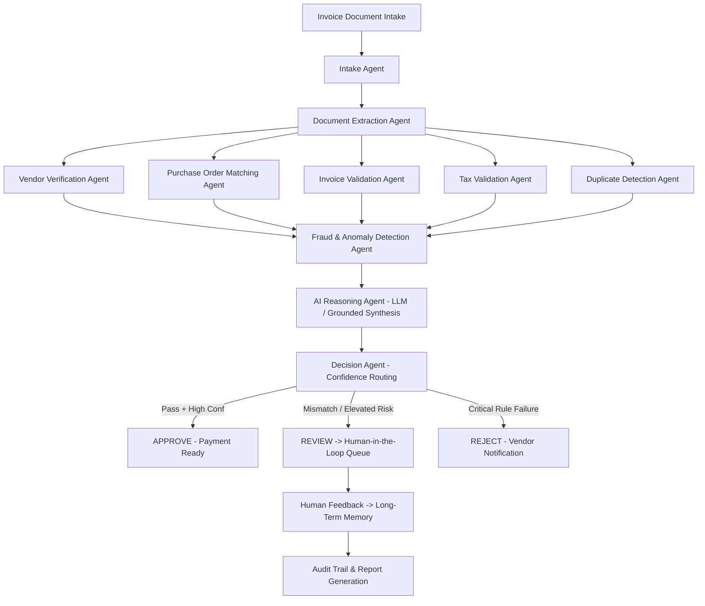

# Intelligent Invoice Analysis and Processing Agent Using LLM

A production-style, full-stack **Agentic AI Accounts Payable System** featuring a 10-agent collaborative architecture, deterministic mathematical & tax validation, dynamic tool calling, fraud & anomaly detection, three-way purchase order matching, explainable LLM reasoning, human-in-the-loop review queue, and automated PDF/Excel/CSV report generation.

---

## Architecture & Agent Lifecycle

The agent architecture follows the complete autonomous intelligence cycle:

```
Observe → Understand → Extract → Validate → Reason → Use Tools → Make Decision → Take Action → Learn/Remember → Report
```



### The 10 Specialized Agents
1. **Invoice Intake Agent**: Ingests files (PDF, PNG, JPG, JPEG), checks size & format, computes SHA-256 checksum, generates unique `INV-SYS-XXX` reference.
2. **Document Extraction Agent**: Parses layout, extracts key header, vendor, financial, line item, and bank fields with per-field confidence scores.
3. **Vendor Verification Agent**: Compares against approved vendor master, verifies GSTIN Tax ID, detects spending spikes (>100% historical deviation).
4. **Purchase Order Matching Agent**: Performs 3-way line item match with configurable quantity (±5%) and price (±3%) tolerances.
5. **Invoice Validation Agent**: Mandatory fields completeness and deterministic mathematical verification (`Qty × Unit Price` and `Subtotal - Discount + Tax = Total`).
6. **Tax Validation Agent**: Analyzes statutory GST (CGST/SGST/IGST) and VAT rates against configured schedules, flagging rate deviations.
7. **Duplicate Detection Agent**: Fuzzy string comparison across vendor name, invoice number, amount, and binary hash similarity scoring.
8. **Fraud and Anomaly Detection Agent**: Evaluates 12 specific indicators (duplicate, amount spikes, tax rate shifts, repeat numbers, vendor mismatch, suspicious bank account, abnormal quantity, price anomaly, weekend pattern, unusual frequency, modified patterns, missing mandatory info) -> consolidated Risk Score (0-100).
9. **AI Reasoning Agent**: Synthesizes evidence from all agents, invokes `LLMService` (with local deterministic fallback), produces grounded explanations without hallucination.
10. **Decision Agent**: Evaluates confidence and risk routing matrix, assigns final status (`approved`, `review_required`, `rejected`), dispatches human review tasks, and triggers notifications.

---

## Technology Stack

- **Frontend**: React 18, TypeScript, Tailwind CSS, Recharts, Lucide React icons, Vite
- **Backend**: Python 3.13, FastAPI, Pydantic v2, SQLAlchemy, SQLite (PostgreSQL compatible)
- **Document Processing**: PyPDF, Regex heuristic extraction, ReportLab (PDF generation), OpenPyXL (Excel generation)
- **LLM Abstraction**: `LLMService` supporting local Ollama (`llama3`, `mistral`), OpenAI-compatible endpoints, and a high-fidelity local deterministic reasoning fallback.

---

## Quick Start (Running Locally)

### 1. Start the Backend

```powershell
# In the workspace root
.\venv\Scripts\python -m uvicorn backend.app.main:app --host 127.0.0.1 --port 8000 --reload
```
The backend will initialize the database schema and automatically seed benchmark demo data.
- API Documentation: [http://127.0.0.1:8000/docs](http://127.0.0.1:8000/docs)
- Health Check: [http://127.0.0.1:8000/api/health](http://127.0.0.1:8000/api/health)

### 2. Start the Frontend

```powershell
cd frontend
npm run dev
```
Open [http://localhost:5173](http://localhost:5173) in your browser.

---

## 4 Benchmark Demo Scenarios (1-Click Run)

The application includes built-in test invoices to demonstrate the multi-agent system instantly:

| Scenario | Vendor | Amount | Primary Agent Findings | Decision |
|---|---|---|---|---|
| **1. Clean Invoice** | ABC Technologies | ₹59,000 | 18% GST match, PO match, clean math, low risk (15/100) | **APPROVE** |
| **2. PO Mismatch** | XYZ Solutions | ₹125,000 | Invoice Qty 120 exceeds PO Qty 100 by +20 (+20% diff, tolerance 5%) | **REVIEW** |
| **3. Duplicate Invoice** | ABC Technology | ₹59,000 | 94% similarity match to existing INV-10025, repeat number | **REVIEW (Critical)** |
| **4. Tax Mismatch** | Delta Systems | ₹102,400 | Billed 28% GST vs expected statutory schedule 18% | **REVIEW (High Risk)** |

You can run each demo from the **"Run Benchmark Demo"** dropdown in the top header or from the **Upload Invoice** page!

---

## Human-in-the-Loop & Long-Term Memory

When an invoice is routed to `REVIEW`:
1. It appears in the **Review Queue** with flagged anomalies and evidence.
2. An authorized reviewer can **Authorize & Approve** or **Reject Transaction**, providing comments.
3. The human override decision is stored in the `human_feedback` table.
4. Future analyses for the same vendor retrieve this feedback context from long-term memory.

---

## AI Invoice Chat Assistant

The interactive AI assistant in `/ai-assistant` is grounded in application data. Ask questions like:
- *"Why was invoice INV-10025 flagged?"*
- *"Compare invoice INV-20450 with PO-2026-042"*
- *"What is the tax breakdown for invoice INV-30911?"*
- *"Are there any duplicate invoices in the system?"*
- *"Which invoices currently need human review?"*

---

## Automated Test Suite

Run the full pytest automated test suite:

```powershell
.\venv\Scripts\python -m pytest backend\tests
```
Verifies math validation, tax calculation, PO matching tolerances, fraud risk scoring, and REST API endpoints.
